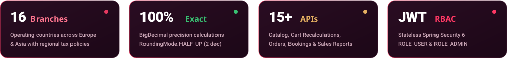
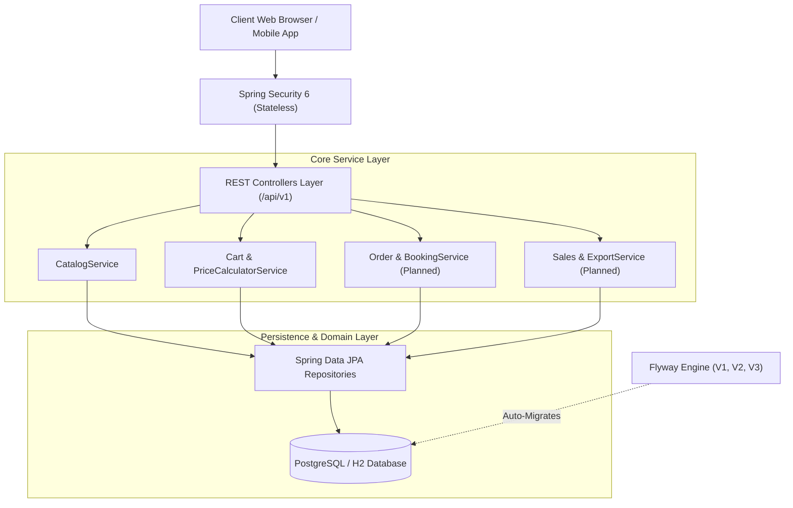
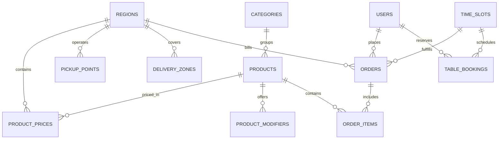

<p align="center">
  
</p>

<p align="center">
  
  
  
  
  
  
  
  
</p>

<p align="center">
  <a href="http://localhost:8080/swagger-ui.html"></a>
  <a href="http://localhost:8080/api/v1/catalog/regions"></a>
  <a href="#team--raci-governance"></a>
</p>

<p align="center"></p>

# 🌸 Cherry Cake - Bakery & Café Web Application API

> **ITPU Team 9 — Confectionery & Café Web Application (Week 1: Setup & Architecture Baseline)**  
> Welcome to the official repository of **Team 9** (`t09-cherry-cake`). This project represents the foundational deliverable for **Week 1** of our 5-week Scrum lifecycle: establishing the multi-region database architecture across **16 sovereign nations**, versioned Flyway migrations, core domain models, the financial-grade `BigDecimal` calculation engine, interactive Swagger documentation, and automated CI pipelines.

<p align="center"></p>

## Global Executive Metrics

<p align="center">
  
</p>

<p align="center"></p>

## Table of Contents

- [Week 1 Milestone Deliverables](#week-1-milestone-deliverables)
- [16 Operating Countries & Regional Matrix](#16-operating-countries--regional-matrix)
- [Mathematical Pricing & Calculation Pipeline](#mathematical-pricing--calculation-pipeline)
- [Interactive Swagger UI & API Status](#interactive-swagger-ui--api-status)
- [System Architecture & Directory Structure](#system-architecture--directory-structure)
- [Database Schema & Flyway Evolution](#database-schema--flyway-evolution)
- [5-Week Project Roadmap](#5-week-project-roadmap)
- [Team & RACI Governance](#team--raci-governance)
- [Technology Stack](#technology-stack)
- [Getting Started & Local Setup](#getting-started--local-setup)
- [Testing & Quality Assurance](#testing--quality-assurance)

<p align="center"></p>

## Week 1 Milestone Deliverables

During **Week 1** (Project Setup & Foundation), Team 9 accomplished the following core baseline engineering targets:

- **16-Country Relational Database Baseline**: Normalized relational schema implemented and auto-migrated via Flyway (`V1__init_schema.sql`, `V2__seed_data.sql`, `V3__add_expanded_regions.sql`).
- **Financial-Grade Server-Side Calculation**: Zero floating-point rounding errors through Java `BigDecimal` with strict `RoundingMode.HALF_UP` to two decimal places, verified by unit tests across regional currencies.
- **Dynamic Localization Engine**: Seeding of 16 countries across Europe, Central Asia, and the Caucasus with national currencies and statutory VAT rates (8.00% to 25.50%).
- **Interactive Administrator Web Panel & Swagger UI**: Customized dark-themed administration landing view (`index.html`) embedded with SpringDoc OpenAPI 3.0 documentation.
- **Domain Persistence Layer**: 12 Spring Data JPA entities, repositories, and centralized error handling with `ApiResponse<T>`.
- **Engineering Standards & CI Pipelines**: Automated GitHub Actions CI workflow, Checkstyle compliance rules (`checkstyle.xml`), and JaCoCo code coverage reporting.

<p align="center"></p>

## 16 Operating Countries & Regional Matrix

<p align="center">
  
  
  
  
  
  
  
  
  
  
  
  
  
  
  
  
</p>

The database schema is seeded with 16 operating countries, localized pricing matrices, flagship pickup points, and delivery logistics zones:

| Country | Code | Currency | Symbol | Legal VAT | Flagship Hub Address | Delivery Zone |
| :--- | :---: | :---: | :---: | :---: | :--- | :--- |
| **Uzbekistan** | `UZB` | `UZS` | `soʻm` | 15.00% | Central Bakery Tashkent (Amir Temur Ave 45) | Tashkent Central Ring |
| **Kazakhstan** | `KAZ` | `KZT` | `₸` | 20.00% | Almaty Downtown Flagship (Dostyk Ave 89) | Almaty Central District |
| **Georgia** | `GEO` | `GEL` | `₾` | 12.00% | Tbilisi Old Town Bakery (Rustaveli Ave 14) | Tbilisi Central |
| **Ukraine** | `UKR` | `UAH` | `₴` | 8.00% | Kyiv Podil Café (Sahaidachnoho St 22) | Kyiv Central |
| **China** | `CHN` | `CNY` | `¥` | 18.00% | Beijing Chaoyang Boutique (Sanlitun Rd 19) | Beijing Inner Ring |
| **Belarus** | `BLR` | `BYN` | `Br` | 20.00% | Central Bakery Minsk (Nezavisimosti Ave 25) | Minsk Central Zone |
| **Lithuania** | `LTU` | `EUR` | `€` | 21.00% | Vilnius Old Town Bakery (Pilies g. 12) | Vilnius Central |
| **Latvia** | `LVA` | `EUR` | `€` | 21.00% | Riga Art Nouveau Café (Elizabetes iela 33) | Riga Central |
| **Estonia** | `EST` | `EUR` | `€` | 22.00% | Tallinn Rotermann Boutique (Rotermanni 8) | Tallinn Kesklinn |
| **Finland** | `FIN` | `EUR` | `€` | 25.50% | Helsinki Esplanadi Café (Pohjoisesplanadi 21) | Helsinki Kamppi & Center |
| **Sweden** | `SWE` | `SEK` | `kr` | 25.00% | Stockholm Gamla Stan Bakery (Stortorget 7) | Stockholm Inner City |
| **Moldova** | `MDA` | `MDL` | `L` | 20.00% | Chisinau Central Boutique (bd. Stefan cel Mare 105) | Chisinau Centru |
| **Romania** | `ROU` | `RON` | `lei` | 19.00% | Bucharest Lipscani Café (Strada Lipscani 45) | Bucharest Sector 1 & Central |
| **Turkey** | `TUR` | `TRY` | `₺` | 20.00% | Istanbul Nisantasi Flagship (Abdi Ipekci Cd. 38) | Istanbul Besiktas & Sisli |
| **Azerbaijan** | `AZE` | `AZN` | `₼` | 18.00% | Baku Nizami Street Bakery (Nizami St. 68) | Baku Sabail & Central |
| **Armenia** | `ARM` | `AMD` | `֏` | 20.00% | Yerevan Abovyan Café (Abovyan St. 14) | Yerevan Kentron |

<p align="center"></p>

## Mathematical Pricing & Calculation Pipeline

<p align="center">
  
</p>

All computations in `PriceCalculatorService` use Java `BigDecimal` with `RoundingMode.HALF_UP` to two decimal places:

### 1. Line Item Subtotal
$$\text{LineTotal}_i = (P_{i,\text{region}} + \sum \Delta M_k) \times Q_i$$

### 2. Order Subtotal
$$\text{Subtotal} = \sum_{i=1}^{n} \text{LineTotal}_i$$

### 3. Statutory VAT Computation
$$\text{VAT} = \text{Subtotal} \times \left( \frac{\text{VAT\_Rate}_{\text{region}}}{100} \right)$$

### 4. Amount Including VAT
$$\text{Amount}_{\text{incl\_VAT}} = \text{Subtotal} + \text{VAT}$$

### 5. Tiered Threshold & Promo Discounts
Threshold discounts are evaluated progressively against $\text{Amount}_{\text{incl\_VAT}}$:

| Threshold Condition | Discount Tier Name | Applied Percentage |
| :--- | :--- | :---: |
| $\text{Amount}_{\text{incl\_VAT}} \ge 100$ | Tier 1 Threshold Discount | 3.00% |
| $\text{Amount}_{\text{incl\_VAT}} \ge 500$ | Tier 2 Threshold Discount | 5.00% |
| $\text{Amount}_{\text{incl\_VAT}} \ge 700$ | Tier 3 Threshold Discount | 7.00% |
| $\text{Amount}_{\text{incl\_VAT}} \ge 1000$ | Tier 4 Threshold Discount | 10.00% |
| $\text{Amount}_{\text{incl\_VAT}} \ge 5000$ | Tier 5 Threshold Discount | 15.00% |
| Valid Code `WELCOME10` | Promo Code Discount | 10.00% |

$$\text{DiscountAmount} = \text{Amount}_{\text{incl\_VAT}} \times \left( \frac{\text{DiscountRate}}{100} \right)$$

### 6. Final Order Total
$$\text{Total} = \text{Amount}_{\text{incl\_VAT}} - \text{DiscountAmount} + \text{DeliveryFee}$$

> [!NOTE]
> Delivery fees are applied strictly after discounts and taxes have been computed. For bakery pickup orders, delivery fee evaluates to `0.00`.

<p align="center"></p>

## Interactive Swagger UI & API Status

<p align="center">
  
</p>

### Week 1 Active & Planned REST Endpoints

| HTTP Method | Route | Description | Sprint Target | Status |
| :--- | :--- | :--- | :---: | :---: |
| `GET` | `/api/v1/catalog/regions` | Retrieve list of 16 operating countries, currencies, and tax rates | **Week 1** | **Active Baseline** |
| `GET` | `/api/v1/catalog/categories` | Retrieve active confectionery and bakery categories | **Week 1** | **Active Baseline** |
| `POST` | `/api/v1/cart/calculate` | Recalculate subtotal, regional statutory VAT, discount tiers, and totals | **Week 1** | **Active Baseline** |
| `GET` | `/api/v1/catalog/products` | Retrieve catalog items with regional prices (`?region=UZB`) | **Week 2 (Sprint 1)** | Planned |
| `GET` | `/api/v1/catalog/products/{id}` | Retrieve single product details with modifier add-ons | **Week 2 (Sprint 1)** | Planned |
| `POST` | `/api/v1/orders` | Submit new order with server-side validation and price lock | **Week 3 (Sprint 2)** | Planned |
| `POST` | `/api/v1/bookings` | Book table with date-time slot verification and conflict checks | **Week 3 (Sprint 2)** | Planned |
| `GET` | `/api/v1/catalog/pickup-points` | Retrieve physical bakery pickup locations for a specified region | **Week 4 (Sprint 3)** | Planned |
| `GET` | `/api/v1/catalog/delivery-zones` | Retrieve delivery logistics zones and rates for a specified region | **Week 4 (Sprint 3)** | Planned |
| `POST` | `/api/v1/auth/login` | Authenticate with credentials and receive Bearer JWT | **Week 4 (Sprint 3)** | Planned |
| `GET` | `/api/v1/reports/sales` | Aggregate monthly revenue, order volume, and regional breakdown | **Week 5 (Sprint 4)** | Planned |

<p align="center"></p>

## System Architecture & Directory Structure



### Directory Structure

```text
t09-cherry-cake/
├── .github/
│   ├── CODEOWNERS                  # Team code ownership rules
│   ├── PULL_REQUEST_TEMPLATE.md    # PR checklist and task CC-id tracker
│   └── workflows/
│       └── backend-ci.yml          # GitHub Actions CI (build, checkstyle, tests)
├── docs/
│   └── assets/                     # Animated SVG banners, dashboards, and diagrams
├── checkstyle.xml                  # Team code formatting and style rules
├── pom.xml                         # Maven dependencies & build plugins
├── README.md                       # Week 1 project documentation & architecture guide
└── src/
    ├── main/
    │   ├── java/uz/itpu/cherrycake/
    │   │   ├── CherryCakeApplication.java
    │   │   ├── common/
    │   │   │   ├── exception/      # Unified error handling (@RestControllerAdvice)
    │   │   │   └── response/       # Consistent ApiResponse<T> payloads
    │   │   ├── config/             # SecurityConfig, CORS, OpenAPI Swagger
    │   │   ├── controller/         # Catalog, Cart, Order, Booking, Report
    │   │   ├── dto/                # Request & Response Data Transfer Objects
    │   │   ├── model/entity/       # 12 JPA Entities (Region, Product, Price, etc.)
    │   │   ├── repository/         # Spring Data JPA Repository Interfaces
    │   │   ├── security/           # JWT Provider, Token Filter, UserDetails
    │   │   └── service/            # Business Services & PriceCalculatorService
    │   └── resources/
    │       ├── application.yml     # Application configuration (PostgreSQL)
    │       ├── application-h2.yml  # In-memory H2 configuration
    │       ├── db/migration/       # Flyway schema (V1), seed (V2), expansion (V3)
    │       └── static/             # Frontend assets, playlist, themed error views
    └── test/
        ├── java/uz/itpu/cherrycake/
        │   ├── CherryCakeApplicationTests.java
        │   ├── controller/CartControllerTest.java
        │   └── service/PriceCalculatorServiceTest.java
        └── resources/
            └── application-test.yml
```

<p align="center"></p>

## Database Schema & Flyway Evolution

Database evolution is versioned through Flyway migrations located in `src/main/resources/db/migration/`:

```text
db/migration/
├── V1__init_schema.sql            # Creates 12 normalized relational tables, constraints, indexes
├── V2__seed_data.sql              # Seeds baseline 5 countries, products, modifiers, discount tiers
└── V3__add_expanded_regions.sql   # Expands catalog with 11 European and Caucasian countries (16 total)
```

### Relational Schema Design



<p align="center"></p>

## 5-Week Project Roadmap

The repository serves Team 9 across our 5-week Scrum development roadmap:

| Stage | Timeline | Focus Area | Technical Deliverables & Outcomes | Status |
| :---: | :---: | :--- | :--- | :---: |
| **Week 1** | Current | Project Setup & Foundation | RACI Matrix, Git repo, DB schema (V1–V3 16 regions), `PriceCalculatorService`, CI pipeline | **Completed** |
| **Week 2** | Sprint 1 | Catalog & Pricing API | Dynamic catalog endpoints (`/api/v1/catalog`), cart calculation contract (`/api/v1/cart/calculate`), UI Kit integration | Planned |
| **Week 3** | Sprint 2 | Orders & Reservations | Order placement, server price locks, table reservations, double-booking prevention | Planned |
| **Week 4** | Sprint 3 | Fulfillment & Security | Pickup slots, delivery zone validation, JWT authentication filters, customer dashboard | Planned |
| **Week 5** | Sprint 4 | Analytics & Final Review | Sales reports, CSV/PDF export, stress testing, Project Plan Alignment Analysis | Planned |

<p align="center"></p>

## Team & RACI Governance

The project is developed by **Team 9** (`t09-cherry-cake`) following Scrum methodologies and RACI governance:

| Role Code | Team Member | Primary Domain & Responsibilities |
| :---: | :--- | :--- |
| **TL** | **Milana Ulubabyan** | Team Lead: Architecture decisions, code review checklist, branch protection |
| **AS** | **Andrei Varnavskiy** | Deputy Team Lead: Task tracking, UI prototype, technical documentation |
| **BE1** | **Adrian Zakirov** | Backend Dev 1: Catalog API, PriceCalculatorService (BigDecimal), Cart API, Flyway |
| **BE2** | **Anvar Makhamatjonov** | Backend Dev 2: Order fulfillment, time slots, table booking, reports & exports |
| **FE1** | **Shovkat Khabidullaev** | Frontend Dev 1: Design tokens, layouts, UI kit, regional switcher |
| **FE2** | **Arjumandbonu Narzullaeva** | Frontend Dev 2: Product cards, modifiers dialog, live cart counter, admin views |
| **FE3** | **Mukhammademin Emminov** | Frontend Dev 3: Multi-step checkout, validators, account history, responsive UI |
| **QAJ** | **Muhammadyusuf Ismatov** | QA Backend: API test plans, Postman collections, calculation formula validation |
| **QAF** | **Asadbek Yulchiev** | QA Frontend: WCAG AA accessibility, responsive breakpoints (320/768/1200px), axe |

### RACI Accountability Matrix

| Task Domain | TL | AS | BE1 | BE2 | FE1 | FE2 | FE3 | QAJ | QAF |
| :--- | :---: | :---: | :---: | :---: | :---: | :---: | :---: | :---: | :---: |
| DB Architecture & Flyway Migrations | A | I | R | C | I | I | I | C | I |
| PriceCalculatorService (BigDecimal) | A | I | R | C | C | C | I | R | I |
| Catalog & Multi-Region APIs | A | I | R | C | C | C | I | C | I |
| Order Fulfillment & Booking Engine | A | I | C | R | I | C | C | C | I |
| Sales Reports, CSV & PDF Exports | A | I | C | R | I | C | I | C | I |
| Design Tokens & UI Layouts | A | C | I | I | R | C | C | I | C |
| Product Modifiers & Cart UI | A | I | C | I | C | R | C | I | C |
| Multi-Step Checkout & Auth UI | A | I | I | C | C | C | R | I | C |
| API & Calculation QA Verification | A | C | C | C | I | I | I | R | I |
| UI/UX & Cross-Device Accessibility | A | C | I | I | C | C | C | I | R |

> Legend: **R** = Responsible, **A** = Accountable, **C** = Consulted, **I** = Informed.

<p align="center"></p>

## Technology Stack

- **Java Web Application**: OpenJDK 21 LTS
- **Build & Dependency Management**: Apache Maven 3.9+
- **Core Framework**: Spring Boot 3.3.4 (Spring MVC, Spring Data JPA, Spring Security 6)
- **Database Engine**: PostgreSQL 16+ (Production / Development), H2 In-Memory (Automated Testing)
- **Database Migrations**: Flyway Core (Versioned SQL migrations)
- **Security & Tokens**: Stateless JWT (`io.jsonwebtoken` JJWT 0.12.6) with BCrypt password hashing
- **API Documentation**: SpringDoc OpenAPI 3.0 / Swagger UI 2.6.0
- **Testing & Quality**: JUnit 5, Mockito, AssertJ, MockMvc, JaCoCo, Checkstyle

<p align="center"></p>

## Getting Started & Local Setup

### Prerequisites
- **Java**: OpenJDK 21 LTS
- **Build Tool**: Apache Maven 3.9+
- **Database**: PostgreSQL 15+ (or run tests directly with bundled H2)

### Build and Run

```bash
# 1. Clone the repository
git clone https://github.com/itpu-cherry-cake/t09-cherry-cake.git
cd t09-cherry-cake

# 2. Compile and package the application
mvn clean package

# 3. Launch the Spring Boot application
mvn spring-boot:run
```

### Interactive Documentation & Health Endpoints

Once the application is running:
- **Web Landing Page**: `http://localhost:8080`
- **Interactive Swagger UI**: `http://localhost:8080/swagger-ui.html`
- **Raw OpenAPI 3.0 Specification**: `http://localhost:8080/v3/api-docs`

<p align="center"></p>

## Testing & Quality Assurance

The codebase includes automated test suites covering repository layers, `PriceCalculatorService` rounding rules, and REST API controllers:

```bash
# Run unit and integration test suites
mvn clean test

# Execute Checkstyle code formatting validation
mvn checkstyle:check

# Generate JaCoCo test execution coverage report
mvn jacoco:report
```

HTML coverage reports are generated at:
`target/site/jacoco/index.html`

<p align="center"></p>

<p align="center">
  
  
  
  
  
  
  
  
  
</p>

<p align="center">
  <i>ITPU University Teamwork Project &bull; Scrum Team 9 (t09-cherry-cake) &bull; Spring Boot 3.3.4 &bull; Java 21 LTS</i><br>
  <strong>🌸 Cherry Cake Bakery &amp; Café Web Application</strong>
</p>
