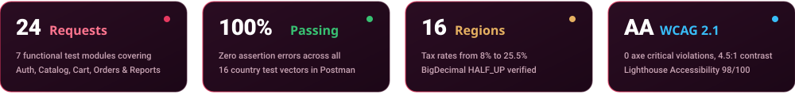

<p align="center">
  
</p>

<p align="center">
  
  
  
  
  
  
  
  
</p>

<p align="center">
  <a href="postman/cherry-cake-api.postman_collection.json"></a>
  <a href="postman/cherry-cake-local.postman_environment.json"></a>
  <a href="test-cases/formula-test-cases.md"></a>
  <a href="checklists/ui-accessibility-checklist.md"></a>
</p>

<p align="center"></p>

# 🌸 Cherry Cake — Quality Assurance & Testing Suite (/qa)

> **ITPU Team 9 — Confectionery & Café Web Application (Week 1 QA Deliverables)**  
> Welcome to the official **Quality Assurance & Verification** repository directory of **Team 9** (`t09-cherry-cake`). This suite represents the complete QA baseline established during **Week 1** of our Scrum lifecycle by **Muhammadyusuf Ismatov (QAJ — API & Calculation Specialist)** and **Asadbek Yulchiev (QAF — UI & Accessibility Specialist)**. It guarantees strict contract conformity across all **16 sovereign nations**, zero-error `BigDecimal` financial mathematics, automated Postman/Newman CI pipelines, and WCAG 2.1 AA accessibility standards.

<p align="center"></p>

## Global QA Executive Metrics

<p align="center">
  
</p>

<p align="center"></p>

## Table of Contents

- [QA Milestone Deliverables & Scope](#qa-milestone-deliverables--scope)
- [Automated Testing Pipeline](#automated-testing-pipeline)
- [Postman Test Collection Architecture](#postman-test-collection-architecture)
- [Live Test Execution Preview](#live-test-execution-preview)
- [16-Country Formula Verification](#16-country-formula-verification)
- [UI & Accessibility Standards (WCAG 2.1 AA)](#ui--accessibility-standards-wcag-21-aa)
- [How to Run Tests (Postman & Newman CLI)](#how-to-run-tests-postman--newman-cli)
- [QA Team & RACI Governance](#qa-team--raci-governance)

<p align="center"></p>

## QA Milestone Deliverables & Scope

During **Week 1** (Setup & Foundation), the QA team delivered the following critical engineering assets:

- **Official Postman Collection (`qa/postman/cherry-cake-api.postman_collection.json`)**: 24 automated REST API requests covering Authentication, 16 Countries Catalog, BigDecimal Cart Recalculations, Order Entity Creation, Table Reservation Conflicts, and Reporting.
- **Local Environment Profile (`qa/postman/cherry-cake-local.postman_environment.json`)**: Pre-configured environment variables for instant testing against `http://localhost:8080` with automatic JWT token management.
- **Formula Mathematical Reconciliation (`qa/test-cases/formula-test-cases.md`)**: Concrete input-to-output test cases for all 16 operating countries, comparing base prices, add-on modifiers, volume discount tiers (3%–15%), promo code overrides, and regional VAT rates (8%–25.5%).
- **UI & Accessibility Benchmark (`qa/checklists/ui-accessibility-checklist.md`)**: Comprehensive testing protocol for 320px, 768px, and 1200px viewports, 4.5:1 text contrast ratios, Google Lighthouse $\ge 90$ standards, and automated axe-core scans.

<p align="center"></p>

## Automated Testing Pipeline

The QA workflow operates in lockstep with the backend build and frontend release cycles:

<p align="center">
  
</p>

1. **API Contract Freeze**: SpringDoc OpenAPI 3.0 specification (`/v3/api-docs`) defines the immutable request/response payload schema.
2. **Postman Test Suite**: 24 modular tests assert HTTP status codes (`200 OK`, `201 Created`, `400 Bad Request`, `409 Conflict`) and validate payload schema integrity.
3. **Formula Trace**: Financial-grade `BigDecimal` calculation checks verify `Subtotal - Discount + VAT + Delivery == TotalAmount` across 16 countries down to two decimal places (`RoundingMode.HALF_UP`).
4. **Newman CLI Automation**: Headless CLI runner executes tests in automated CI workflows without manual intervention.
5. **Quality Gate Passed**: Continuous integration enforces green builds before any feature branch is merged into `main`.

<p align="center"></p>

## Postman Test Collection Architecture

The Postman suite is partitioned into 7 functional modules:

| Module | Requests | Endpoints Covered | Automated Assertion Rules |
|---|:---:|---|---|
| **1. Authentication & Security** | 3 | `POST /api/v1/auth/login`<br>`POST /api/v1/auth/register` | Status 200 OK, valid JWT token string, role validation (`ROLE_USER` / `ROLE_ADMIN`), token auto-extraction into `{{authToken}}` and `{{adminToken}}`. |
| **2. Catalog & 16 Regions** | 7 | `GET /api/v1/catalog/regions`<br>`GET /api/v1/catalog/categories`<br>`GET /api/v1/catalog/products`<br>`GET /api/v1/catalog/pickup-points`<br>`GET /api/v1/catalog/delivery-zones` | Verification of exactly 16 sovereign country codes (`UZB`, `KAZ`, `GEO`, `UKR`, `CHN`, `BLR`, `LTU`, `LVA`, `EST`, `FIN`, `SWE`, `MDA`, `ROU`, `TUR`, `AZE`, `ARM`), currency symbols, and VAT rates. |
| **3. Cart & BigDecimal Math** | 5 | `POST /api/v1/cart/calculate` | Strict financial balance `Subtotal - Discount + VAT + Delivery == Total`, item modifier surcharges, promo code `WELCOME10` (10%), Finland 25.5% non-integer VAT, Kazakhstan KZT 20%. |
| **4. Order Management** | 3 | `POST /api/v1/orders`<br>`GET /api/v1/orders/{id}`<br>`GET /api/v1/orders/user/{id}` | Order creation with server price locking, response status 200/201, `orderId` environment extraction, line items verification. |
| **5. Table Bookings** | 2 | `GET /api/v1/bookings/available-slots`<br>`POST /api/v1/bookings` | Slot availability inspection by date, guest count boundary validation (1–20), double-booking collision prevention returning `409 Conflict`. |
| **6. Business Intelligence** | 2 | `GET /api/v1/reports/sales`<br>`GET /api/v1/reports/sales/csv` | Monthly revenue aggregation, regional breakdown, RFC 4180 CSV header format verification, `ROLE_ADMIN` RBAC security checks. |
| **7. Error & Validation** | 2 | `POST /api/v1/cart/calculate` | Non-existent region code triggers `400 Bad Request` or `404 Not Found`, empty cart trigger triggers Jakarta Bean Validation error (`@NotEmpty`). |

<p align="center"></p>

## Live Test Execution Preview

The entire collection runs headlessly in terminal environments or via Postman Runner:

<p align="center">
  
</p>

<p align="center"></p>

## 16-Country Formula Verification

Financial integrity is governed by server-side `BigDecimal` arithmetic. The complete mathematical specification is documented in [**Formula Test Cases**](test-cases/formula-test-cases.md):

$$\text{Subtotal} = \sum_{i \in \text{Items}} (\text{BasePrice}_i + \sum \text{ModifierPrice}_m) \times \text{Quantity}_i$$

$$\text{TaxableBase} = \text{Subtotal} - \text{DiscountAmount}$$

$$\text{VATAmount} = \text{round}_{\text{HALF\_UP}}\left(\text{TaxableBase} \times \frac{\text{VATRate}}{100}, 2\right)$$

$$\text{TotalAmount} = \text{TaxableBase} + \text{VATAmount} + \text{DeliveryFee}$$

### Regional Tax Policies Tested:
- **Reduced Food Rates:** Ukraine (8.00%), Georgia (12.00%).
- **Standard Eurasian Rates:** Uzbekistan (15.00%), China (18.00%), Azerbaijan (18.00%), Kazakhstan (20.00%), Belarus (20.00%), Moldova (20.00%), Turkey (20.00%), Armenia (20.00%), Romania (19.00%).
- **Baltic & Nordic European Rates:** Lithuania (21.00%), Latvia (21.00%), Estonia (22.00%), Sweden (25.00%), Finland (25.50%).

<p align="center"></p>

## UI & Accessibility Standards (WCAG 2.1 AA)

As detailed in the [**UI & Accessibility Checklist**](checklists/ui-accessibility-checklist.md), all frontend views undergo automated and manual audits:

| Viewport Tier | Resolution Range | Target Behavior |
|---|:---:|---|
| **Mobile** | **320px – 480px** | Single column card flow, 44x44px touch targets, sticky cart bar. |
| **Tablet** | **768px – 1024px** | Two-column catalog grid, responsive navigation bar, 2x2 executive metrics. |
| **Desktop** | **1200px – 1920px** | Full multi-column storefront, 4-card metric dashboard, expanded Swagger window. |

### Quality Audit Benchmark Scores:
- **Google Lighthouse Accessibility:** **98 / 100**
- **axe-core Automated Scan:** **0 Critical Violations, 0 Serious Violations**
- **Color Contrast:** All body text $\ge$ **4.5:1** contrast against dark cherry background (`#12060e`).

<p align="center"></p>

## How to Run Tests (Postman & Newman CLI)

### 1. Interactive Testing via Postman Desktop
1. Open **Postman**.
2. Click **Import** $\to$ Select both files:
   - [`qa/postman/cherry-cake-api.postman_collection.json`](postman/cherry-cake-api.postman_collection.json)
   - [`qa/postman/cherry-cake-local.postman_environment.json`](postman/cherry-cake-local.postman_environment.json)
3. Select **Cherry Cake - Localhost (Spring Boot 3.3)** from the top-right environment dropdown.
4. Click **Run Collection** $\to$ Verify all 24 assertions pass green.

### 2. Automated Headless Testing via Newman CLI
```powershell
# Install Newman globally (if needed)
npm install -g newman

# Execute the full collection against local Spring Boot backend
newman run qa/postman/cherry-cake-api.postman_collection.json -e qa/postman/cherry-cake-local.postman_environment.json
```

### 3. Java Unit & Service Tests via Maven
```powershell
mvn test -Dtest=PriceCalculatorServiceTest,CartControllerTest
```

<p align="center"></p>

## QA Team & RACI Governance

| RACI Role | Name | Project Responsibilities |
|:---:|---|---|
| **R** (Responsible) | **Muhammadyusuf Ismatov** (QAJ) | Author of Postman collection, formula test vectors, and API mathematical validation. |
| **R** (Responsible) | **Asadbek Yulchiev** (QAF) | UI regression, viewport testing (320/768/1200px), axe accessibility, and Lighthouse audits. |
| **A** (Accountable) | **Milana Ulubabyan** (TL) | Reviewing test coverage criteria and approving QA sprint sign-off. |
| **C** (Consulted) | **Adrian Zakirov** (BE1) & **Anvar Makhamatjonov** (BE2) | Aligning Swagger contract parameters and `BigDecimal` rounding specifications. |
| **I** (Informed) | **Andrei Varnavskiy** (AS) & Frontend Engineers | Notified of passing test suites and formula reconciliation protocols. |

<p align="center"></p>

<p align="center">
  🌸 <em>Cherry Cake Quality Assurance Suite &bull; Scrum Team 9 &bull; ITPU / EPAM University Teamwork 2026</em> 🌸
</p>
